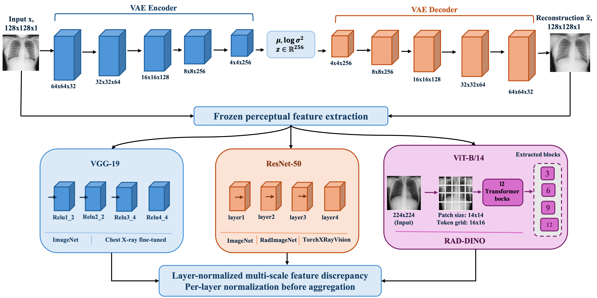

# Perceptually Augmented VAEs for Chest Radiograph Anomaly Detection

The project asks whether the choice of perceptual representation used to
supervise a VAE's reconstruction objective changes how useful the
reconstruction residual is for anomaly detection. It trains one VAE
architecture seven ways, a pixel-only control plus six perceptual variants
spanning two CNN families, one transformer, and four pretraining corpora,
with everything else (splits, optimiser, anomaly score, evaluation) held
fixed, then evaluates reconstruction fidelity, image-level detection, and
pixel-level localisation on the COVID-19 Radiography Database and RSNA
Pneumonia dataset. A same-feature PaDiM reference separates what the frozen
representation contains from what the reconstruction residual retains. The
headline result: perceptual losses reliably improve reconstruction fidelity,
especially on deep-feature metrics, but that improvement does not transfer
into materially better detection or localisation.



## Repository layout

```
common/                  shared by every stage, edit once
  dataset.py, rsna_dataset.py    loaders, lung masks, control splits
  vae_model.py                   the VAE
  losses.py                      the objective
  perceptual.py                  frozen backbone registry and perceptual loss
  train.py  evaluate.py  controls.py  visualize.py  figure_dashboard.py
  padim_baseline.py  mean_image_baseline.py          reference baselines
  metrics.py  fidelity_metrics.py  scoring.py        fidelity/detection metrics
  loc_evaluate.py  loc_maps.py  loc_visualize.py      pixel-level localisation

stage1_vae/, stage1_vae_rsna/        VAE, pixel loss only (the control)
stage2_vgg19/, stage2_vgg19_rsna/    + VGG-19, ImageNet weights
stage3_vgg19_cxr/, ..._rsna/         + VGG-19, fine-tuned on chest radiographs
stage4_resnet_imagenet/, ..._rsna/   + ResNet-50, ImageNet weights
stage5_resnet_radimagenet/, ..._rsna/+ ResNet-50, RadImageNet weights
stage6_resnet_cxr/, ..._rsna/        + ResNet-50, chest radiograph weights (TorchXRayVision)
stage7_raddino/, ..._rsna/           + RAD-DINO (ViT-B/14, DINOv2, chest radiographs)
```

Each `stageN_*` folder (the plain one for COVID-19 Radiography, the `_rsna`
one for RSNA Pneumonia) holds only what makes that run different from the
control: a `config.yaml` and two PBS job scripts. Everything else lives in
`common/`, so there is no second copy of `vae_model.py` to drift out of sync.
That matters here because the whole experiment rests on the seven objectives
being identical except in the final loss term.

`stage1_vae/` and `stage1_vae_rsna/` also hold the trivial references (mean
image, 8x8 thumbnail probe) and the same-feature PaDiM baseline
(`common/padim.aqua`) that Table 2 reports alongside the seven reconstruction
objectives.

This release covers exactly the seven-objective comparison the paper
reports. Later pipeline stages (inpainting-based scoring, MARS, spatial/DAE
corruption variants) are part of ongoing thesis work built on the same
`common/` library and aren't included here.

## Requirements

```bash
pip install -r requirements.txt
```

`torchxrayvision` is only needed for the ResNet-50-CXR backbone (stage 6);
the other stages don't import it. RAD-DINO (stage 7) is pulled from the
Hugging Face hub on first use.

## Order, and the two places to stop and look

**Before any training**, on the login node. Takes two minutes, needs no model:

```bash
cd stage1_vae
python ../common/controls.py --config config.yaml
```

Read the `lowres` and `border` AUROCs. Near 0.5 means proceed. Above about
0.7 means a linear model separates your classes from 8x8 thumbnails or from
the image borders alone, so that separation is available without any anatomy
and the detector will find it too. That does not make the experiment
worthless, but it changes what any later AUROC can claim. (This is why the
COVID-19 Radiography Database results are reported in parallel with RSNA in
the paper, and why RSNA carries the localisation claims: see
`common/base_rsna.yaml` for the probe numbers that motivate it.)

**A smoke test before a ten-hour job:**

```bash
sed 's/max_epochs: 300/max_epochs: 2/' config.yaml > _smoke.yaml
python ../common/train.py --config _smoke.yaml
```

Check that `recon` and `kl` are finite, and that `kl_per_dim` is not already
pinned at the free-bits floor of 0.5.

**Stage 1 first, and read `controls.json` before `eval_results.json`.** The
normal-versus-normal AUROC must land near 0.5. If it does not, the scoring
pipeline separates images of the same class and nothing downstream is
trustworthy. Every later stage would inherit exactly the same problem, so
running them first only costs queue time.

**Stages 4-7 need a calibration pass first.** The weight on the perceptual
term does not transfer between backbones, each network has its own
activation scale:

```bash
cd stage4_resnet_imagenet
python ../common/calibrate_perceptual_weight.py --config config.yaml
# put the recommended value in loss.perceptual.weight, then submit as usual
```

**Stage 3 needs one manual step first.** The normalisation statistics for a
chest-radiograph-fine-tuned VGG-19 cannot be recovered from the weights:

```bash
cd stage3_vgg19_cxr
python ../common/perceptual.py --inspect <path to your vgg19_cxr checkpoint>
```

This reports the detected input channel count and dumps any config stored in
the checkpoint, flagging anything that looks like a normalisation statistic.
If it reports 1 channel, `loss.perceptual.normalization` is required and
training stops until it is set. If it reports 3 channels and you leave it
null, training runs on ImageNet statistics with only a warning in the log,
which is the silent-failure case worth avoiding.

**Check `share_perc` in the epoch-1 log line.** Five to thirty percent is
healthy. Below one percent means the perceptual term is contributing nothing
and the run is just stage 1 under another name, so kill it and raise
`loss.perceptual.weight`.

## What the seven objectives are for

Stages 4, 5, and 6 are architecturally identical ResNet-50s differing only in
pretraining domain (ImageNet, RadImageNet, chest radiographs), which is the
only design that lets a difference between them be attributed to the domain
rather than to the network computing the features. Stages 2 and 3 do the
same for VGG-19 (ImageNet vs. a chest-radiograph fine-tune). Stage 7
(RAD-DINO) sits outside that ladder: it's self-supervised rather than
discriminative, and a transformer rather than a convolutional network, so its
layer selection spans depth rather than scale.

To add another backbone, copy a stage folder, change `experiment.name`,
`paths.output_root`, and `loss.perceptual.backbone`. `common/perceptual.py`
also registers `densenet_imagenet` and `densenet_cxr`.

## Design choices, and why

A few choices here depart from common practice for VAE-based anomaly
detection, for reasons that matter specifically for detection rather than
for reconstruction quality alone. They're listed below next to the code that
implements each one.

### Benchmark validity comes first

The COVID-19 Radiography Database assembles each class from different source
repositories. DeGrave, Janizek and Lee (*Nature Machine Intelligence*, 2021)
showed that COVID radiograph models built on such data learn acquisition
shortcuts rather than pathology, appearing accurate while failing elsewhere.
Unsupervised training is not exempt: a model fitted to one source's contrast
curve and border padding reconstructs another source worse for reasons that
have nothing to do with lungs. `common/controls.py` probes for this directly
before any model is trained.

### Scoring, not architecture, is where the performance is

- **Top-k pooling** instead of the mean. Averaging over 16,384 pixels divides
  a 3 percent lesion's signal by about 33. On synthetic maps with realistic
  per-image variation, a 1 percent lesion scores AUROC 0.618 under mean
  pooling and 1.000 under top-1 percent. All poolings are computed in one
  pass and reported together; `scoring.primary` names the one to quote.
- **Lung-masked scoring.** The COVID masks ship with the dataset; ignoring
  them hands the detector every border and marker shortcut. The model still
  sees the whole image; only the score is restricted. RSNA ships no
  segmentations, so this is off for the RSNA stages (`use_masks: false` in
  `common/base_rsna.yaml`).
- **Sigma-normalised residuals**, so the score is not dominated by regions
  the model was never going to predict.

### Model choices

| | Common setup | Here | Why |
|---|---|---|---|
| Normalisation | none | GroupNorm/InstanceNorm | BatchNorm would make a per-sample score depend on the batch |
| Bias | disabled | enabled | no reason to omit once norm is affine |
| Output | linear, unbounded | sigmoid | removes clamping decisions from SSIM, LPIPS and the backbone |
| Upsampling | ConvTranspose | resize + conv available | transposed-conv artifacts land in the residual map used for localisation |
| Variance | fixed at 1 | optional per-pixel sigma head (off by default) | rib margins and the diaphragm would otherwise dominate a raw residual |
| Depth | plain conv stack | residual blocks per scale | depth without lengthening the stride-2 path |

### Objective

A common setup sums reconstruction over pixels (order 1.5e4) and KL over
dimensions, which makes every weight resolution-dependent. Here
reconstruction is a per-pixel mean, KL is summed then divided by the pixel
count, and the perceptual term is a mean over feature maps (Eq. 2 in the
paper). All three are order 1, so `beta` and `perceptual.weight` are
dimensionless, portable across resolutions, and start near 1. Free bits (0.5
nats per dimension) stop latent dimensions from dying; KL warmup over 20
epochs stops the latent collapsing to the mean image.

### Evaluation

Model selection is on **validation ELBO over held-out normals**, never on
detection score: the only labelled data for the latter is the test set.
Detection metrics carry **bootstrap 95 percent confidence intervals**
(`evaluation.bootstrap` in the config), and AUPRC is always reported with its
chance baseline, which is class prevalence, not 0.5.

## Known limitations

These are stated in the paper's discussion and limitations section; they're
repeated here next to the code that produces the affected numbers.

- **No patient identifiers** in either dataset, so images from one patient
  may straddle a split. Absolute numbers should be read as optimistic.
- **RSNA annotations are coarse bounding boxes**, not pixel-precise masks, so
  `pix AUPRC` / `pix AUROC` / Dice / IoU in Table 2 are lower bounds on
  localisation quality, not exact figures.
- **Reconstruction-based detection is a weak family here.** The same-feature
  PaDiM reference (`common/padim_baseline.py`) outperforms every VAE variant
  on both detection and localisation using the *same* frozen representation,
  which is why the paper's conclusion is about the reconstruction mechanism
  rather than about any one backbone.

## Citation

xxxx

```bibtex
xxx
```

## Acknowledgements

We acknowledge support from the Queensland University of Technology (QUT) through its provision of subsidised access to specialised research infrastructure including HPC, and the eResearch team at QUT for providing expertise in enablement of this project.

\